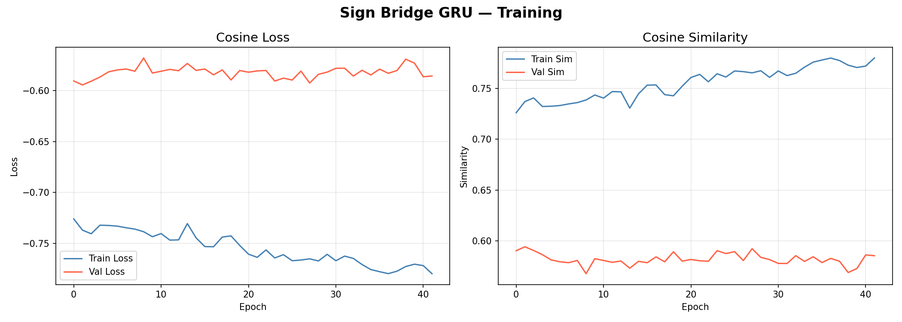

# Sign Bridge — Sign-to-Text Model Report

**Project:** Sign Bridge — a bidirectional mobile sign-language translation application
**Module:** Sign → Text (isolated word recognition)
**Author:** Abdur Rehman Zubair
**Model name:** `SignBridge_GRU`

---

## 1. Objective

The Sign → Text module recognises an isolated American Sign Language (ASL) word
from a short video clip of a person signing, and returns the corresponding
English word. The model runs **on-device** (offline) inside the Flutter mobile
application, taking body/hand/face landmarks produced in real time by Google
MediaPipe as input.

## 2. Dataset

| Property | Value |
|---|---|
| Source | **WLASL** (Word-Level ASL), pre-encoded as *"MuteMotion: WLASL MediaPipe Encoded"* |
| Vocabulary (classes) | **351 words** |
| Training samples | 2,770 clips |
| Validation samples | 748 clips |
| Test samples | 560 clips |
| Per-frame raw landmarks | 553 (MediaPipe Holistic: 21 + 21 hands, 33 pose, 478 face) |

Each word (gloss) is associated with a **300-dimensional FastText semantic word
vector**, which is used as the model's regression target (see §4).

## 3. Feature Engineering

From the 553 raw MediaPipe Holistic landmarks per frame, a **180-landmark**
subset is selected (the most informative points for signing):

- 21 right-hand + 21 left-hand landmarks
- 6 upper-body pose points (shoulders, elbows, wrists)
- 132 face-mesh points (mouth, eyes, eyebrows, face contour)

Each landmark keeps its `(x, y, z)` coordinate, giving a per-frame feature of
shape `180 × 3`.

**Preprocessing (identical in training and in the mobile app):**

1. **Hand normalisation** — each hand is re-centred on its wrist and scaled by
   its own span, making the model invariant to hand position and distance from
   the camera. Pose and face points are kept in normalised image coordinates.
2. **Temporal resampling** — every clip is linearly interpolated to exactly
   **64 frames**, so variable-length signs become a fixed-size tensor.

**Final model input:** `64 × 180 × 3` (frames × landmarks × coordinates).

**Data augmentation** (training only, ×3 augmented copies → **11,080** training
clips): random Z-rotation, scaling, translation, horizontal flip (with
left/right-hand swap), temporal warping, frame dropping, random landmark
dropout, and Gaussian noise.

## 4. Model Architecture

`SignBridge_GRU` is a recurrent sequence encoder with attention pooling that
outputs a **300-dimensional L2-normalised embedding** (not a softmax classifier).

```
Input (64, 180, 3)
  → Reshape (64, 540)
  → TimeDistributed Dense(256, ReLU) + LayerNorm + Dropout(0.2)
  → Bidirectional GRU(256, return_sequences) + LayerNorm
  → Bidirectional GRU(128, return_sequences) + LayerNorm
  → Attention pooling  (learns which frames matter most)
  → Dense(512, ReLU) + Dropout(0.4)
  → Dense(256, ReLU) + Dropout(0.3)
  → Dense(300, linear) → L2-normalize
Output: 300-d unit vector
```

- **Total trainable parameters: 1,763,373 (≈ 1.76 M).**
- **Why embedding regression instead of a 351-way softmax?** The model predicts
  a point in FastText word-vector space and is matched to the nearest word by
  **cosine similarity**. This lets semantically related signs share structure
  and makes the vocabulary easy to extend without retraining the output layer.

## 5. Training Configuration

| Setting | Value |
|---|---|
| Loss | Negative cosine similarity (embedding alignment) |
| Optimiser | Adam with warm-up + cosine-decay learning rate (peak 1e-3) |
| Batch size | 64 |
| Regularisation | Dropout 0.2–0.4, recurrent dropout 0.1, heavy augmentation |
| Early stopping | Monitored `val_cosine_sim`, patience 40, best weights restored |
| Hardware | Kaggle GPU (~0.54 s/step, 174 steps/epoch) |
| Epochs | ~97 total (trained in two resumed runs), **stopped early** on validation plateau |

## 6. Results

### 6.1 Retrieval accuracy (nearest-word by cosine similarity)

| Split | Samples | Top-1 | Top-3 | Top-5 |
|---|---|---|---|---|
| **Validation** | 748 | **24.73 %** | **37.97 %** | **42.38 %** |
| **Test** | 560 | **24.82 %** | **35.71 %** | **38.93 %** |

- **Random-chance baseline** for 351 classes is `1/351 = 0.28 %`. The model's
  Top-1 accuracy is therefore **~88× better than chance**.
- Best validation cosine similarity reached **≈ 0.59**.

### 6.2 Training curves



The **training** cosine similarity rises steadily to ~0.78 while the
**validation** similarity plateaus at ~0.58–0.59. This gap indicates
**over-fitting**, which is why early stopping was used and the best-validation
checkpoint was kept for deployment.

## 7. Deployment (on-device)

| Property | Value |
|---|---|
| Format | TensorFlow Lite, dynamic-range quantised |
| Size | **3.0 MB** |
| Input / Output | `[1, 64, 180, 3]` → `[1, 300]` |
| Runtime | Flutter + `tflite_flutter`; landmarks from MediaPipe **Holistic** (GPU delegate) |
| Verified device | Google Pixel 6 Pro (real-time) |

The model was re-exported with the recurrent layers **unrolled** so the TFLite
graph uses only built-in operators (no TensorFlow "Flex" ops), which is required
for it to load in the mobile TensorFlow Lite runtime. The app displays the
**top-3** candidate words with confidence and assembles recognised words into a
sentence.

## 8. Discussion

- **A 351-word isolated-sign task is genuinely hard.** Landmark-based models are
  lightweight and privacy-preserving (no raw video leaves the device), but they
  discard appearance information, so a Top-1 of ~25% with a Top-5 of ~40% is a
  reasonable, honest result for this setting and vocabulary size.
- **Top-k matters for usability.** Because the correct word appears in the top-3
  for ~36–38% of test clips, the app surfaces the top-3 rather than only the
  single best guess.
- **Over-fitting is the main limiter**, driven by the modest amount of data per
  class (~8 training clips/word on average before augmentation).

## 9. Limitations & Future Work

1. **More data / regularisation** to close the train–validation gap (additional
   WLASL samples, mixup, stronger dropout, or self-supervised pre-training).
2. **Transformer temporal encoder** as an alternative to the BiGRU stack.
3. **Continuous signing** (sentence-level segmentation), moving beyond one
   isolated word at a time.
4. **Vocabulary expansion** beyond 351 words.
5. **Quantisation-aware training** to recover any accuracy lost to on-device
   quantisation.
6. On-device, 2 of the 132 face points (iris landmarks) are zero-filled because
   the mobile Holistic model returns 468 face points vs. 478 used in training —
   a negligible difference the model tolerates (it was trained with random
   landmark dropout).

---

*All figures in this report were taken directly from the model's own training
logs and evaluation output (Kaggle notebook `abdurrehmanzubair/sign-bridge`).*
